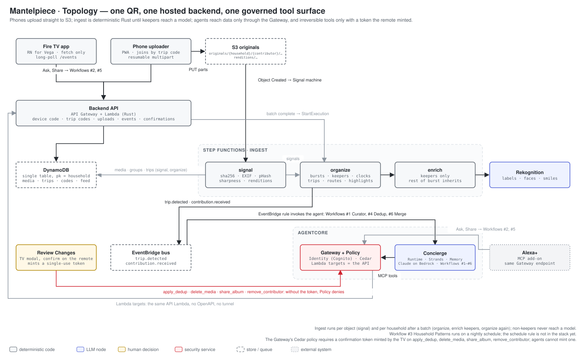

# MemoryLane

Turn a family trip into a shared album that builds itself, on the living-room TV.

MemoryLane is a Fire TV app plus a hosted backend. Install the app, scan the QR on the TV,
pick photos on your phone. Everyone on the trip scans the same QR and adds theirs. The
backend groups bursts, scores highlights, reconstructs the route, writes a day-by-day story,
and an agent keeps the archive tidy. Ask about any trip from the TV or from Alexa+.

Entry for Build, Ship, Shape: Amazon Developer Hackathon 2026.
Tracks: Fire TV (primary), Alexa+ (secondary). Mini-challenges: AWS Builder, Open Source.

## Documents

- [specs/architecture.md](specs/architecture.md): architecture, required features, workflows, open questions
- [specs/hackathon.md](specs/hackathon.md): entry strategy, rules, timeline, demo plan, judge access
- [specs/decisions-2026-09-09.md](specs/decisions-2026-09-09.md): Fire TV research log: sample repo, Vega RN pin, Virtual Device, Builder Tools, voice
- [docs/diagrams/](docs/diagrams/): architecture diagrams as SVG source



## Layout

```
packages/tv-ui/  Fire TV screens, hooks and API client: React Native core only, no native modules
apps/tv-vega/    Vega OS shell: manifest, Metro, React Native pinned to the Vega SDK line (0.83)
apps/web/        Phone pages: link (approve the TV code) and upload (join by code, resumable uploads)
services/        Rust workspace
  crates/core    domain types, device-code and trip-code flows, confirmation tokens
  crates/ingest  checksum, EXIF, pHash, quality signals, burst grouping, renditions
  crates/trips   event and trip clustering, clock alignment, routes, naming, highlights
  crates/store   Storage and Blobs traits: DynamoDB, S3, in-memory
  lambdas/api    backend API Lambda behind API Gateway
  lambdas/ingest Step Functions tasks: signal, enrich, organize
  lambdas/poster poster frames for videos (ffmpeg from a Lambda layer)
agents/          Concierge workflows W1 to W6 for AgentCore Runtime (Python, uv)
infra/           CDK stack (TypeScript)
scripts/         tv-walkthrough.sh: Virtual Device key presses and screenshots
```

## Build and test

```
make test        # cargo test, vitest/jest, pytest
make lint        # rustfmt + clippy, eslint + tsc, ruff
make build-lambdas   # cargo-lambda, arm64, into services/target/lambda
scripts/ffmpeg-layer.sh   # static ffmpeg into infra/assets/ffmpeg-layer for the poster Lambda
make deploy      # cdk deploy (needs AWS credentials and Login with Amazon client id/secret)
```

Everything under `make test` runs without AWS. The DynamoDB, S3, Step Functions,
Rekognition, Bedrock, Polly, Location, SES, EventBridge and AgentCore Gateway backends are
compile-checked only until the stack is deployed.

### What shipped (2026-09-09)

The baseline in `specs/001-memorylane-baseline/` is code-complete with in-memory tests:
TV sign-in and persisted sessions, contributor and member-household codes, resumable
uploads, ingest with bursts, clocks, trips, routes and keepers, stories checked against
metadata, search and playlists, Ask by voice with `describe_photo`, dedup and quick-cleanup
proposals behind the Review Changes token, People opt-in, resurfacing memories, reactions,
the ambient and narrated slideshow, expiring shares, the Alexa+ OAuth surface, the audit
log and tracing spans. Not verified: anything on a Vega device or the Virtual Device (no
SDK on the build machine), every AWS-backed implementation (no deploy yet), the Alexa+
registration (preview not granted). See `docs/friction-log.md` and `docs/alexa-plus.md`.

### Fire TV app

The TV code is split in two. `packages/tv-ui` holds every screen, hook and the API client
and is tested with jest against upstream React Native. `apps/tv-vega` is the Vega OS shell:
`manifest.toml`, `app.json`, Metro config, and React Native 0.83 with
`@amazon-devices/react-native-kepler` 4, both from public npm, so `pnpm install` needs no
Vega registry token. The Babel preset `@amazon-devices/kepler-module-resolver-preset` maps
ported libraries to their `@amazon-devices/*` equivalents at bundle time.

```
cd apps/tv-vega
pnpm bundle:vega           # JS + Hermes bundle only; runs in CI, no SDK needed
pnpm start                 # Metro
pnpm build:vega:debug      # react-native build-vega: bundle, then .vpkg (needs the Vega SDK)
pnpm build:vega            # release .vpkg
make tv-vvd-start          # Virtual Device plus Metro port forward
make tv-vvd-install        # debug build and install on the Virtual Device
make tv-vvd-logs           # log stream
make tv-walkthrough        # scripts/tv-walkthrough.sh: key presses and screenshots into docs/screens
```

The `.vpkg` step and everything on the Virtual Device need the
[Vega SDK](https://developer.amazon.com/docs/vega/0.24/install-vega-sdk.html) 0.24 with
the `vega` CLI on `PATH`. Verified so far: the bundle builds locally and contains only the
kepler React Native. Not yet verified: packaging, install and behaviour on a device.

Platform-specific code goes in `.kepler.ts` files next to the default implementation (see
`packages/tv-ui/src/hooks/useRemoteKeys.kepler.ts`); Metro picks them on Vega and falls back
to the plain file elsewhere. Screens keep text inside the 1080p title-safe margin defined in
`packages/tv-ui/src/theme.ts`. Do not add a `resolver.resolveRequest` to the shell's Metro
config: it replaces the React Native CLI resolver that maps `react-native` to the kepler
package.

## Contributing

See [CONTRIBUTING.md](CONTRIBUTING.md) and [CODE_OF_CONDUCT.md](CODE_OF_CONDUCT.md).

## License

MIT, see [LICENSE](LICENSE).
